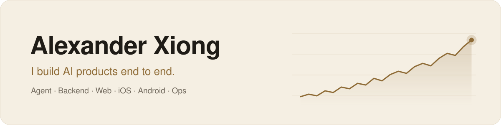

<picture>
  <source media="(prefers-color-scheme: dark)" srcset="./assets/banner-dark.svg">
  <source media="(prefers-color-scheme: light)" srcset="./assets/banner-light.svg">
  
</picture>

  📍 Singapore &nbsp;&nbsp;·&nbsp;&nbsp; 💼 Open to new roles &nbsp;&nbsp;·&nbsp;&nbsp; 🌐 <a href="https://aiquant.io">aiquant.io</a>

### 👋 About me

Most AI products need a team: someone for the model, someone for the backend, a web developer, an iOS developer, an Android developer, and someone to get paged at 3 a.m. For [Quant AI](https://aiquant.io), an AI research assistant for investors, that team is me.

I've built and run it on my own since April 2025. It's live on the web and the App Store, and real investors use it to research stocks, crypto and commodities.

### 💡 What I bring

- 🤖 **AI agents built for production, not demos.** One conversation can move from US stocks to A-shares to crypto without losing context. Answers stream in and can be stopped mid-sentence, memory carries across sessions, and a backup model takes over when the main one fails.
- 📈 **A quant's skepticism.** The agent rates about 200 US stocks. I keep the rating model only if its scores predict later excess returns at t ≥ 2, not because a few picks went well.
- 📱 **Every screen.** Native SwiftUI on iPhone, iPad and Mac, Jetpack Compose on Android, and Nuxt on the web.
- 🚦 **Ops I can sleep through.** A git tag ships a release; dashboards and alerts tell me about a problem before users do.
- 🧑‍✈️ **A team of AI agents.** I write the issue. Claude Code agents write the code, run the checks and pass an independent review before anything ships. My time goes to design and decisions.

### 🛠️ Tech stack

<picture>
  <source media="(prefers-color-scheme: dark)" srcset="https://skillicons.dev/icons?i=py,ts,swift,kotlin,fastapi,postgres,redis,supabase,vue,nuxtjs,tailwind,docker,githubactions,grafana,prometheus,cloudflare&perline=8&theme=dark">
  <source media="(prefers-color-scheme: light)" srcset="https://skillicons.dev/icons?i=py,ts,swift,kotlin,fastapi,postgres,redis,supabase,vue,nuxtjs,tailwind,docker,githubactions,grafana,prometheus,cloudflare&perline=8&theme=light">
  
</picture>

Also LangChain · LangGraph · OpenAI Responses API · Temporal · Stripe · RevenueCat

### 📊 By the numbers

<table>
  <tr>
    <td align="center" width="25%"><h3>1</h3>person on the team</td>
    <td align="center" width="25%"><h3>5</h3>platforms built</td>
    <td align="center" width="25%"><h3>16</h3>languages supported</td>
    <td align="center" width="25%"><h3>8,500+</h3>commits in 19 months</td>
  </tr>
</table>

### 🧭 How I work

- **Simple beats clever.** My bar is rsync: one job, done well, nothing extra. I'd rather delete a layer than explain it.
- **Logs before code.** What the system actually did beats what the code seems to say.
- **Fix the cause.** If the fix is a try/except, I haven't found the bug yet.
- **Boring and official first.** Standard tools and documented patterns, unless I can write down why not.
- **Write it down.** 70+ decision records, so the next person, or agent, doesn't have to guess.
