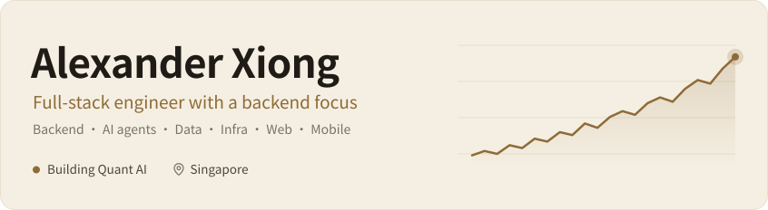

<b>English</b> · <a href="./README.zh-CN.md">简体中文</a>

<picture>
  <source media="(prefers-color-scheme: dark)" srcset="./assets/banner-en-dark.svg">
  <source media="(prefers-color-scheme: light)" srcset="./assets/banner-en-light.svg">
  
</picture>

  📍 Singapore &nbsp;&nbsp;·&nbsp;&nbsp; 💼 Open to backend and full-stack roles &nbsp;&nbsp;·&nbsp;&nbsp; 🌐 <a href="https://aiquant.io">aiquant.io</a>

### 👋 About me

I'm a full-stack engineer in Singapore with a backend focus. Most of my work is the part users don't see: APIs, data, background jobs and the servers they run on. I also build the web and mobile apps, so I can take an AI product from idea to launch on my own.

Since April 2025 I've built and run [Quant AI](https://aiquant.io), an AI research assistant for investors, by myself. It is live on the web and the App Store, and investors use it to research stocks, crypto and commodities.

### 💡 What I do

- 🧱 **Backend.** I build services in Python and FastAPI on PostgreSQL and Redis, run scheduled jobs on Temporal, and handle payments, sign-in and push notifications.
- 🤖 **AI agents.** I build agents that work reliably in production: multi-turn conversations across markets, streaming answers, long-term memory, and automatic fallback when a model fails.
- 📈 **Quant research.** I built a rating system for about 200 US stocks and test it against real market returns, so decisions rest on statistics rather than a few lucky picks.
- ⚙️ **Infrastructure.** I run production myself, including automated releases, monitoring and alerts.
- 📱 **Web and mobile.** I build native apps for iPhone, iPad, Mac and Android, plus the web app, all in 16 languages.
- 🧑‍💻 **AI-assisted development.** I set up a workflow where AI coding agents implement, test and review changes, which lets one person maintain a product of this size.

### 🛠️ Tech stack

<picture>
  <source media="(prefers-color-scheme: dark)" srcset="./assets/stack-en-dark.svg">
  <source media="(prefers-color-scheme: light)" srcset="./assets/stack-en-light.svg">
  
</picture>

### 🧭 How I work

- **Keep it simple.** I choose the simplest design that solves the problem and remove code that is no longer needed.
- **Fix the root cause.** I trace a problem to its source instead of hiding the symptom.
- **Trust real results.** I check logs and real behavior before I call something done.
- **Use proven tools.** I start with official tools and common practice, and build my own only when there is a clear reason.
- **Document decisions.** I write down key technical decisions so others can pick up the work quickly.
